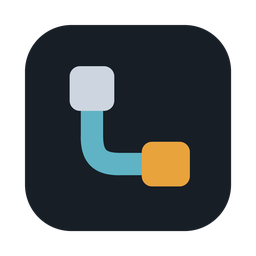

  

<h1 align="center">Lepons</h1>

<a href="README.md">한국어</a> · <b>English</b> · <a href="README.zh-CN.md">中文</a>

<b>One screen for the AI agents on all your PCs</b>

Split the screen for AI sessions, terminals and files, and share code between computers. Manage remote PCs and AI sign-ins, then check and answer sessions from your phone when away.

<!-- SCREENSHOT: hero
     File: added later by the screenshot job (e.g. screenshots/hero.png)
     Shows: the main window with sessions from several machines in panes and tabs
     alt: "Lepons main window: machines and folders on the left, AI sessions from several machines in panes and tabs on the right" -->

## Download

**[Get the latest version](https://github.com/joyuno/lepons/releases/latest)** · Website: [lepons.app](https://lepons.app/en/)

| Device | Where |
|---|---|
| Windows 10/11 | the `.exe` installer on the [latest release](https://github.com/joyuno/lepons/releases/latest) |
| macOS (Apple Silicon, M1 or later) | the `.dmg` on the [latest release](https://github.com/joyuno/lepons/releases/latest) |
| iPhone | In App Store review. Coming soon. |
| Android | download the `.apk` directly from the [latest release](https://github.com/joyuno/lepons/releases/latest). Google Play is coming too. |

### Install

- **Windows**: run the `.exe`. The installer can be shown in Korean, English or Chinese. If "Windows protected your PC" appears, choose **More info → Run anyway**; the app has no code-signing certificate, which is what triggers the warning. If your browser blocks the download, choose **Keep**.
- **macOS**: open the `.dmg` and drag Lepons Cockpit into Applications. The app is signed and notarized by Apple, so it opens without a warning. From 1.9.6 the in-app update opens the new `.dmg`; drag the new app over the old one and its folder permissions stay.
- **Android**: on the phone, download the `.apk` from the release page and open it. If Android asks you to allow installs from this source, allow it and install. The file's SHA-256 is listed on the release page.

## What it does

### 1. Sharing map — share code with AI on another computer

Drag a folder onto another computer in the sharing map. Its AI can read and search the files it needs, without copying code or moving it through Git.

The receiving AI cannot edit those files directly, but can delegate work to an AI on the computer that owns the folder. Delegated work runs without permission prompts, so share only between computers you trust. Values resembling keys or tokens are masked before being sent.

### 2. Every machine's AI agents in one window

- Click a folder and choose **Claude Code, Codex, Grok, Antigravity, Cursor** or a terminal, and it opens in that folder, whether on this PC or on a VM or server you reach over SSH.
- Split right or down, up to eight panes. A pane gathers one project's (one machine and folder's) AI sessions, terminals and files as tabs; drag a tab to a pane's edge to split off a new pane.
- Markdown, code, images, PDF and HTML open in a pane, and files on remote machines can be edited in place and saved with **Ctrl+S** (**⌘+S** on macOS).
- Nothing is installed on remote machines; SSH is enough. Remote sessions run inside tmux, so closing the laptop or losing the network does not stop the agent, and reopening puts you back on the same screen.

### 3. Workflow map

<!-- SCREENSHOT: workflow-map
     File: added later by the screenshot job (e.g. screenshots/workflow-map.png)
     Shows: machine hubs branching into folders, sessions and subagents, with summaries under each item
     alt: "Workflow map: a hub per machine branching into folders, sessions and subagents, each session showing what it is doing now and its goal" -->

See what each session set out to do, how far it got, what it is doing now and whether it is waiting for you, without reading its record. Open it with **Workflow** at the bottom left or **Ctrl+Shift+M** (**⌘⇧M** on macOS).

- **A hub per machine.** This PC and every remote PC or VM has its own hub, branching into folders → sessions → subagents. The ring around a hub shows its connection state.
- **Summaries that are always there.** The summary under each item shows without hovering. Click a session for a summary card on the right (**Goal · Progress · Now · Result**), with its steps below.
- **Needs you N.** When sessions are waiting for an answer, **Needs you N** appears in the top bar. Click it to see the next waiting session on the map, then **Go to its pane** to answer there. The map itself is watch-only.
- **Focus mode.** Double-click a hub or folder to see just that branch; Esc goes back.
- **Follow.** When on, the map moves to a session that starts working or waits for you. Touching the map pauses it for 30 seconds.
- **Motion only where it means something.** Running handoffs between machines and shares flow as dashed lines, faint dots flow into working sessions, and waiting sessions blink their outline. Everything else stays still.

### 4. Phone app

<!-- SCREENSHOT: phone
     File: added later by the screenshot job (e.g. screenshots/phone.png)
     Shows: the phone app's home (usage, session states) and a session's conversation
     alt: "Lepons phone app: home shows running and waiting sessions and usage limits; the session screen shows the conversation and lets you answer" -->

When you step away, the **Lepons** app for iPhone and Android shows this PC's sessions and lets you answer them.

- **Pair with a QR code.** Scan the QR on the PC with the phone app and check that both screens show the same six digits.
- **End-to-end encrypted.** The phone and PC connect from anywhere through a relay (`relay.lepons.app`); only this PC and the phone can read what passes between them. The relay cannot.
- **Notifications that matter.** The PC and the phone are told only when Claude Code or Codex puts up a choice. Several at once become one notification. Nothing is sent while you are looking at the phone app, and if you leave it unanswered, it is sent then. Notifications carry only the PC's name.
- **Read and answer.** Sessions are laid out like the PC's panes and tabs; read the conversation and send a menu number, Enter or the next instruction. Stop (Esc) takes two taps, and the phone can never quit an agent.
- **Map, files, usage.** See one machine's workflow map at a time, open Markdown, PDF and images from the session's folder, and check Claude and Codex usage limits and AI account state. A **demo** lets you look around without a PC.

### 5. Also

- **Live usage limits**: what is left of your Claude and Codex 5-hour and 7-day limits, as batteries. It updates as soon as Claude on this PC replies; remote sessions update when they finish a turn.
- **AI sign-in on remote machines**: **⚙ Settings → AI accounts** shows which AIs are installed and signed in on each machine, and signs in on remote machines without a terminal.
- **One-click tmux**: a remote machine without tmux shows **Install tmux**; click it and Lepons installs it in the background. If sudo needs a password, Lepons asks once in its own dialog and does not keep it.
- **Pet**: a duck on the desktop (produck) shows which session is waiting for you; click it to open that session.

## Getting started

On the first launch a short guide walks through the main buttons. To see it again, use **⚙ Settings → Tutorial** (Settings is Ctrl+, / ⌘+,).

1. **Add a machine**: at the bottom left, **＋ Add machine** offers **＋ Folder on this computer** and **＋ Remote machine** (`<user>@<IP or host name>`, e.g. `ubuntu@10.0.0.5`). The first time, **Import** is handy: it brings in the places VS Code, Cursor, Claude Code and Codex remember.
2. **First connection**: if the remote machine does not have Lepons's key yet, it asks for the password once and adds the key to `~/.ssh/authorized_keys` for you. The password is not saved.
3. **Open a session**: click a folder and pick an agent. **Continue the last conversation** is on by default, and for Claude Code and Codex **Pick a past conversation…** lets you continue an older one. **Run without permission checks** is off by default; turn it on only in folders you trust.
4. **Connect the phone**: install the Lepons app on the phone. On the PC, open the phone icon → **Phone setup guide**, set a phone sign-in password and an authenticator app (Google Authenticator or similar), and turn on **Allow phone access**. Scan the QR in **⚙ Settings → Phone app → Connect phone app** within two minutes, and if the digits match press **Yes, same** on the PC. Then sign in on the phone with the password and the authenticator code.

### Requirements

- **This PC**: Windows 10/11 or macOS (Apple Silicon)
- **Remote machines**: SSH access (password or key); tmux recommended
- **AI agents**: the agents you use, installed and signed in. If one is missing, Lepons offers to install it and types the official installer into that machine's terminal.
- **Phone (optional)**: the Lepons app. It does not have to be on the same network as the PC. One phone connects to a PC.

## What Lepons connects to

- The machines you add: over SSH only.
- The relay (`relay.lepons.app`): only when you connect the phone app. Content is end-to-end encrypted; the relay cannot read it.
- Phone notifications: when turned on, sent through the Expo push service to Apple and Google push. They carry only the PC's name.
- GitHub: to check for and download new versions.
- Claude (Haiku model): only when you press **Translate** in a workflow step list, using Claude Code on this PC.
- Lepons sends nothing else itself. Each agent connects to its own service.

## FAQ

**What do I need to install on a remote machine?**
Not Lepons. SSH is enough, and tmux is recommended so work survives a dropped connection. The AI agents you use need to be on that machine.

**Can a Windows PC be a remote machine?**
Yes. Windows has its SSH server off, so press **⚙ Settings → Connections from other PCs → Allow…** once in that PC's Lepons. It turns on the OpenSSH server and opens the firewall only to SSH from the same network (LAN). On a work PC, ask your IT team first.

**How do updates work?**
Lepons checks for a new version when it starts and tells you. **Update now** downloads and installs it inside the app. For macOS releases that cannot update in place, it opens the download page. Your machines and settings stay.

**How long does a phone sign-in last?**
Ten hours. The phone cannot reach a PC that is asleep, so turn off sleep in the PC's power settings.

**How is this different from VS Code Remote-SSH or a terminal app?**
Remote-SSH installs VS Code Server on the remote machine to build a dev environment there. Lepons installs nothing remotely, puts agent sessions from many machines in one window, and shows what they are doing on the map and on your phone.

**Is it free?**
Yes. Lepons is an open-source project under the MIT License, and its source code is in this repository.

## Support

- Privacy policy: https://lepons.app/privacy
- Terms of use: https://lepons.app/terms
- Support: https://lepons.app/support
- Questions and feedback: write to [joy981017@gmail.com](mailto:joy981017@gmail.com) about anything, big or small.
- Problems or ideas: [Issues](https://github.com/joyuno/lepons/issues)
