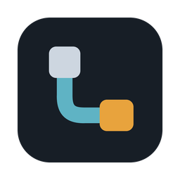

<p align="center">
  
</p>

<h1 align="center">Lepons</h1>

<p align="center"><b>한국어</b> · <a href="README.en.md">English</a> · <a href="README.zh-CN.md">中文</a></p>

<p align="center"><b>여러 PC의 AI 코딩 에이전트를 한 화면에서 관리하는 멀티 PC 에이전트 오케스트레이터</b></p>

<p align="center">이 PC와 원격 서버·VM에서 돌아가는 Claude Code와 Codex를 한 창에서 나눠 보고, PC끼리 코드베이스를 실시간으로 나눠 읽게 하는 데스크톱 앱입니다.</p>

서버, 워크스테이션, 맥북처럼 흩어진 PC마다 터미널을 따로 띄우고 코드나 파일을 복사해 옮기던 일을 한곳으로 모읍니다. 원격 PC에는 아무것도 설치하지 않습니다. SSH 접속만 되면 됩니다.

## 다운로드

**[최신 버전 받기](https://github.com/joyuno/lepons/releases/latest)**

| 운영체제 | 파일 |
|---|---|
| Windows 10/11 | `.exe` 설치 파일 |
| macOS (Apple Silicon, M1 이상) | `.dmg` |

### 설치

- **Windows**: 받은 `.exe`를 실행합니다. 설치 화면은 한국어·영어·중국어 중에서 고를 수 있습니다. "Windows의 PC 보호" 창이 뜨면 **추가 정보 → 실행**을 누릅니다. 코드 서명 인증서가 없는 앱이라 뜨는 경고입니다. 브라우저가 다운로드를 막으면 **유지**를 고릅니다.
- **macOS**: `.dmg`를 열고 Lepons Cockpit을 응용 프로그램 폴더로 끌어다 놓습니다. Apple 공증을 받지 않은 앱이라, 처음 열 때 "Apple이 'Lepons Cockpit'에 악성 코드가 없는지 확인할 수 없습니다" 같은 경고가 뜹니다. 그러면 **시스템 설정 → 개인정보 보호 및 보안**으로 가서 아래쪽의 **그래도 열기**를 누릅니다(1.7.2 이후).

  그래도 열리지 않거나 1.7.1 이하에서 "손상되었기 때문에 열 수 없습니다"가 뜨면, 터미널에서 아래 명령을 한 번 실행한 뒤 다시 엽니다.

  ```sh
  xattr -dr com.apple.quarantine "/Applications/Lepons Cockpit.app"
  ```

## 주요 기능

1. **PC 간 코드베이스 공유**: 공유 맵에서 폴더를 다른 PC 위로 끌어다 놓으면, 그 PC의 Claude Code·Codex가 이 폴더를 읽고 검색할 수 있습니다. git push·pull도, 파일 복사도 필요 없습니다. 공유받은 PC의 에이전트는 이 폴더를 읽기만 하고 직접 고치지는 못합니다. 키·토큰처럼 보이는 값은 가려서 보냅니다. 다만 고칠 일이 있으면 폴더가 있는 PC에 일을 맡길 수 있고(다른 PC에 맡기기), 맡긴 일은 그 PC에서 권한 확인 없이 실행됩니다. 믿을 수 있는 PC끼리만 공유하세요.
2. **자유로운 패널 분할**: 오른쪽이나 아래로 나눠 최대 네 개의 패널을 띄웁니다. 패널마다 다른 PC의 세션이나 파일을 놓고 나란히 봅니다.
3. **Claude Code·Codex·터미널 실행**: 폴더를 누르고 Claude Code, Codex, 터미널 중 하나를 고르면 그 폴더에서 바로 열립니다. Lepons를 켠 뒤 PC마다 첫 실행 때 CLI를 최신 버전으로 올리고, 모델은 CLI의 최신 기본 모델을 따릅니다. 지난 대화를 이어서 시작할 수도 있습니다.
4. **끊겨도 계속되는 작업**: 원격 세션은 tmux 위에서 돌아갑니다. 노트북을 덮거나 네트워크가 끊겨도 에이전트는 하던 일을 계속하고, 다시 열면 그 화면에 그대로 붙습니다.
5. **원격 PC에 설치할 것 없음**: 데몬도, 서버 프로그램도 없습니다. 세션도, 코드 공유도 SSH로만 오갑니다. 처음 연결할 때 비밀번호를 한 번 넣으면 Lepons가 SSH 키를 대신 등록합니다.
6. **패널 안에서 파일 보기·편집**: 마크다운(옵시디언 문법 포함), 코드, 이미지, PDF, HTML을 패널 안에서 보고, 이 PC와 원격 PC의 파일을 그 자리에서 고칩니다. 파일 트리는 VS Code처럼 우클릭으로 복사·붙여넣기·이름 바꾸기·삭제·경로 복사를 합니다.
7. **한눈에 보는 워크플로우**: 세션마다 Claude Code·Codex가 지금 무엇을 하는지, 서브에이전트에게 무엇을 맡겼는지, PC 사이에 어떤 일이 오갔는지를 보드 하나로 봅니다.
8. **이미 쓰던 곳에서 불러오기**: VS Code·Cursor가 기억하는 원격 폴더와 Claude Code·Codex의 세션 기록에서 PC와 폴더를 한 번에 가져옵니다.
9. **폰에서 세션 보기·답하기**: 밖에서도 폰으로 세션의 대화를 읽고, 선택지를 누르거나 다음 지시를 보냅니다. 입력을 기다리는 세션이 생기면 폰으로 알림이 옵니다. Tailscale 안에서만, 비밀번호와 인증 앱 코드로 열립니다.
10. **어디서든 연결**: Tailscale을 쓰면 다른 네트워크에 있는 PC도 같은 계정의 기기 목록에서 골라 바로 추가합니다.
11. **내 차례를 알려 주는 펫**: 바탕화면의 오리(produck)가 입력을 기다리는 세션을 알려 주고, 누르면 그 세션이 열립니다. 직접 고른 캐릭터로 바꿀 수도 있습니다.
12. **여러 세션에 한 번에 보내기**: 같은 지시를 열려 있는 여러 세션에 한 번에 보냅니다.
13. **꺼져도 다시 이어서**: Lepons가 갑자기 꺼졌거나 그냥 닫았어도, 다음에 켤 때 열려 있던 세션과 패널을 모두 되살릴지 물어봅니다.

## 시작하기

처음 실행하면 화면을 따라가며 주요 버튼을 짚어 주는 안내가 나옵니다. 다시 보려면 왼쪽 위 전원 버튼 → **튜토리얼**을 누릅니다. PC마다 필요한 것과 설치 명령은 **＋ PC 추가 → 문서 가이드**에 모아 두었고, 지금 이 PC 상태도 확인해 줍니다.

### 원격 PC 준비

- SSH로 접속할 수 있을 것 (비밀번호 또는 키)
- tmux (권장. 없으면 연결이 끊길 때 그 세션의 작업도 끝납니다)
- Claude Code 또는 Codex 설치와 로그인 (없으면 Lepons가 지금 설치할지 묻고, 그 PC의 터미널에 공식 설치 명령을 넣어 줍니다)

### PC 추가

왼쪽 아래 **＋ PC 추가**를 누르면 다섯 가지를 고를 수 있습니다.

| 버튼 | 하는 일 |
|---|---|
| **＋ 이 PC 폴더** | 이 PC의 폴더를 골라 등록합니다. |
| **＋ 원격 PC** | `<사용자 이름>@<IP주소 또는 호스트명>`을 입력합니다. 예: `ubuntu@10.0.0.5` |
| **＋ Tailscale 기기에서** | 같은 Tailscale 계정에 로그인된 PC 목록에서 골라 추가합니다. 아래 [어디서든 연결](#어디서든-연결-tailscale)을 보세요. |
| **기존 작업 불러오기** | VS Code·Cursor·Claude Code·Codex가 기억하는 곳을 찾아 한 번에 추가합니다. 처음이라면 이것부터 눌러 보세요. |
| **문서 가이드** | 이 PC·원격 PC·Tailscale·폰·펫에 필요한 것과 설치 명령, 이 PC의 Lepons 공개키를 보여 줍니다. |

원격 PC에 Lepons 키가 아직 없으면 비밀번호 칸이 나옵니다. 한 번 입력하면 Lepons가 키를 `~/.ssh/authorized_keys`에 대신 넣고, 그 뒤로는 키로 연결합니다. 비밀번호는 저장하지 않습니다. 서버가 비밀번호 로그인을 막아 두었다면 **문서 가이드**에서 공개키를 복사해 원격 PC의 `~/.ssh/authorized_keys`에 붙여 넣습니다.

### 폴더 열기

왼쪽 목록에서 폴더를 누르면 실행할 도구를 고릅니다.

- **Claude Code / Codex / 터미널** 중 하나를 고르면 그 폴더에서 시작합니다.
- **마지막 대화 이어가기**: 기본으로 체크되어 있습니다. 그 폴더의 지난 대화를 새 세션으로 이어 가고, 이어갈 대화가 없으면 새로 시작합니다.
- **권한 확인 없이 실행**: 기본은 꺼져 있습니다. 꺼 두면 Claude Code는 자동 모드, Codex는 자동 검토로 시작해 위험한 작업만 확인을 받습니다. 켜면 모든 확인을 건너뛰고 Codex는 샌드박스도 끕니다. 믿을 수 있는 폴더에서만 켜세요.

폴더에 마우스를 올리면 나오는 **⚙**에서 터미널 열기·새 파일 만들기·이름 바꾸기·목록에서 삭제(디스크의 파일은 그대로)를 하고, 폴더 이름 왼쪽 꺾쇠로 파일 목록을 엽니다. **터미널 열기**는 Claude·Codex 세션을 그대로 둔 채 같은 폴더의 터미널을 옆에 엽니다. 펼친 파일 목록 위의 버튼으로 새 파일·새 폴더·새로 고침·폴더 모두 접기를 할 수 있습니다. 에이전트나 터미널이 만든 파일이 안 보이면 새로 고침을 누르세요.

## 어디서든 연결: Tailscale

같은 사무실·집 네트워크 밖에 있는 PC도 [Tailscale](https://tailscale.com)로 연결할 수 있습니다. 개인 사용은 무료입니다.

1. 연결할 PC마다 Tailscale을 설치하고 같은 계정으로 로그인합니다. 리눅스 서버용 설치 명령은 **문서 가이드**에 있습니다.
2. **＋ PC 추가 → ＋ Tailscale 기기에서**를 누르면 같은 계정의 PC가 이름·OS·온라인 여부와 함께 나옵니다. 고르면 원격 PC 추가 화면에 주소가 채워집니다. `@` 앞의 사용자 이름이 다르면 고쳐 주세요.
3. 이미 등록한 원격 PC는 전원 메뉴(⏻) → **Tailscale 주소로 바꾸기**에서 옮길 수 있습니다. 폴더와 공유 설정은 그대로 남습니다.

회사 PC라면 먼저 사내 규정을 확인하세요. 회사 PC를 외부망과 이어 주는 셈이라, 보안 정책상 허용되는지가 가장 중요합니다.

## 폰에서 보기

전원 버튼 → **폰 연결…**을 누르면 설정 마법사가 열립니다. 첫 화면에서 켤 것을 체크합니다. 알림을 받으려면 첫 번째 항목(세션 보기·답하기)도 켜야 합니다. 아무것도 체크하지 않으면 아무것도 켜지지 않습니다.

- **휴대폰에서 세션 보기·답하기**
- **입력 대기 알림을 폰으로 받기** (홈 화면에 추가한 웹앱으로 받습니다)

마법사는 Tailscale 설치 → Tailscale 로그인 → 폰에 Tailscale → 로그인 정보(비밀번호와 인증 앱) → 알림 → 폰에서 열기 순서로 안내합니다. 마지막 단계에서 **폰 접속 허용**을 켜고 **HTTPS 주소 만들기**를 누르면 폰에서 열 주소가 QR로 나옵니다. HTTPS 주소를 만들려면 Tailscale 관리 화면에서 HTTPS를 켜야 합니다. 단계마다 건너뛸 수 있고, 다시 열면 끝낸 단계에 ✓가 붙습니다.

폰 페이지에서 할 수 있는 것:

- **세션 목록**: 입력을 기다리는 세션이 맨 위에 옵니다.
- **대화**: 에이전트의 대화 기록을 채팅처럼 읽습니다. 에이전트가 일하는 중이면 지금 상태 한 줄이 보입니다.
- **답하기**: 에이전트가 선택지를 내밀면 버튼으로 고르고, **직접 입력**으로 답을 쓸 수도 있습니다. 입력창에서 `/`를 치면 명령, `@`를 치면 파일 이름을 추천합니다.
- **멈추기**: 에이전트가 하던 작업을 멈춥니다(Esc). 폰에서는 에이전트를 끌 수 없으니, 끄는 것은 PC에서 하세요.
- **작업 흐름**: 지시마다 에이전트가 한 일을 시간순으로 묶어 보여 줍니다.
- **파일**: 세션 폴더의 마크다운, 이미지, PDF, HTML을 읽기 전용으로 봅니다. HTML은 스크립트 없이 보여 줍니다.
- **PC**: 등록한 PC마다 연결 상태를 봅니다.
- **알림**: 홈 화면에 추가한 Lepons에서 **알림 켜기**를 누르면, 세션이 입력을 기다릴 때 "입력 대기" 알림이 옵니다(iPhone은 iOS 16.4 이상, Android는 Chrome). 알림에는 PC와 폴더 이름만 들어가고, 에이전트의 출력은 들어가지 않습니다.

알아 둘 것:

- 폰 페이지는 이 PC의 Tailscale 주소에서만 열립니다. 인터넷에 공개되지 않습니다.
- 한 번 로그인하면 10시간 동안 유지됩니다. 데스크톱의 **폰 연결됨 · 끊기**를 누르면 모든 폰이 바로 로그아웃됩니다.
- 폰에서 보낸 입력은 데스크톱에 "폰에서 입력함"으로 표시됩니다.
- 두 PC에서 Lepons를 쓰면 PC마다 폰 페이지가 따로 있고, 페이지 이름에 PC 이름이 붙어 구분됩니다.
- PC가 잠자기에 들어가면 폰에서 접속할 수 없습니다. 전원 설정에서 잠자기를 꺼 두세요.

## 펫과 입력 대기 알림

- 전원 버튼 → **펫 보이게 하기 → 켜기**로 바탕화면에 오리(produck)를 띄웁니다. 기본은 꺼짐입니다.
- 작업 중, 입력 대기, 완료, 연결 중, 끊김, 쉬는 중에 따라 동작이 바뀌고, 누르면 그 세션이 열립니다. 어디로든 끌어다 놓을 수 있고, 두 번 누르면 화면 오른쪽 아래로 돌아갑니다.
- 같은 메뉴의 **캐릭터 가져오기…**로 상태별 이미지 폴더(`idle.gif`, `working.gif` …, 최소 `idle` 하나)나 Codex Pet 폴더를 가져와 다른 캐릭터로 바꿉니다.
- 왼쪽 목록의 점은 **작업을 마치고 내 입력을 기다리는 세션**에 켜집니다. Lepons가 뒤에 가려져 있을 때 세션이 내 차례가 되면 OS 알림도 뜹니다.

## 공유 맵

왼쪽 아래 **공유 맵**에서 PC끼리 코드를 나눠 읽게 합니다.

- **폴더를 다른 PC 카드 위로 끌어다 놓으면** 공유가 생기고, **선을 누르면** 끊깁니다.
- **화살표는 코드가 가는 방향**입니다. `A → B`이면 B의 Claude Code·Codex가 A의 폴더를 읽습니다. 서로 공유하면 양쪽 화살표(`⇄`) 하나로 보입니다. 선에 마우스를 올리면 누가 무엇을 읽는지 문장으로 나옵니다.
- 공유를 연결하면 Lepons가 그 PC에 Lepons MCP를 자동으로 등록합니다. 공유를 받는 PC 카드의 **MCP 받는 쪽 [Claude] [Codex]** 스위치로 어느 에이전트에 등록할지 고릅니다(처음에는 그 PC의 기본 에이전트만). 이미 열려 있던 세션에는 **lepons 적용** 버튼이 뜨고, 누르면 대화를 이어 가며 다시 엽니다.
- 서로 공유하는 PC들은 나란히 배치되어 화살표가 짧게 이어집니다. 카드를 직접 끌어 옮기면 그 자리를 지킵니다.
- 공유 맵에 연결된 PC를 목록에서 지우면 그 PC와 이어진 공유도 모두 끊깁니다.
- 한 PC의 폴더가 다른 PC 폴더의 패키지를 쓰는 것 같으면(package.json, go.mod, Cargo.toml 등) 점선으로 공유를 제안합니다. 누르면 공유가 생기고, 오른쪽 클릭하면 제안을 숨깁니다.
- 왼쪽 목록에서 폴더 이름 옆 `↗N`은 이 폴더를 읽는 PC 수, PC 이름 옆 `↙N`은 이 PC가 읽는 폴더 수입니다.

### 코드 공유 방식

- 공유 맵에서 연결하면 Lepons가 SSH 연결 위에 역방향 터널을 열고, 그 PC의 Claude Code·Codex에 Lepons MCP를 등록합니다.
- 공유받은 쪽 에이전트는 `search_repo`로 검색하고 `read_file`로 필요한 파일만 엽니다. Lepons는 요청이 올 때마다 원래 PC에서 그 파일이나 검색에 걸린 줄만 읽어 전달합니다.
- 저장소를 통째로 복사하거나 미리 보내지 않습니다. 에이전트가 실제로 읽은 부분만 컨텍스트에 들어가므로 그만큼만 토큰을 씁니다.
- 공유받은 쪽 에이전트는 `delegate_task`로 폴더가 있는 PC에 일을 맡길 수 있습니다. 그 일은 그 PC의 Claude Code나 Codex가 권한 확인 없이 하고, 진행 상황은 `check_delegation`으로 봅니다.

## 워크플로우

왼쪽 아래 **워크플로우**에서 PC별 세션과 서브에이전트, PC 사이의 위임을 한 보드로 봅니다.

- 세션 카드마다 **Claude**(주황) / **Codex**(청록) 표시가 붙습니다.
- 카드를 누르면 그 세션의 지시·메시지·한 일이 시간순으로 나옵니다.
- PC 상자를 끌어 원하는 곳에 둘 수 있고, 옮긴 위치는 다시 켜도 유지됩니다.
- 서브에이전트 지시는 보통 영어로 적힙니다. 카드의 **번역** 버튼을 누르면 화면 언어로 바꿔 보여 줍니다. 누를 때만 이 PC의 Claude(Haiku 모델) 사용량이 조금 듭니다.

## 터미널에서

| 하고 싶은 것 | 방법 |
|---|---|
| 글자 복사 | 드래그로 선택하고 **Ctrl+C** (선택이 없으면 Ctrl+C는 중단 신호) |
| 붙여넣기 | **Ctrl+V**. 스크린샷처럼 이미지만 복사돼 있으면 Claude Code·Codex에 이미지로 첨부됩니다. 원격 PC에는 이미지를 그 PC로 보내 경로를 붙여 넣습니다. |
| 입력 중 줄바꿈 | **Shift+Enter** (Claude Code·Codex) |
| 지난 출력 보기 | 마우스 휠 |
| 링크 열기 | **Ctrl+클릭** (macOS는 **⌘+클릭**). 원격 PC의 `localhost` 주소는 그 PC의 포트를 이 PC로 이어서 열고, 패널 머리에 `🌐 포트 ×`로 남습니다. 🌐로 다시 열고 ×로 닫습니다. |

## 화면

- **사이드 패널**: 맨 위에 전원·테마·접기, 가운데에 PC와 폴더 목록, 맨 아래에 ＋ PC 추가와 공유 맵·워크플로우가 있습니다. 폴더와 PC는 끌어서 순서를 바꾸고, PC 이름 왼쪽 꺾쇠로 그 PC의 폴더 목록을 접습니다(다시 켜도 유지).
- **상태 표시**: 폴더 줄 끝의 점이 초록이면 작업 중, 주황으로 깜빡이면 연결 중, 빨강이면 연결 실패입니다. 작업을 마치고 내 입력을 기다리는 세션에는 따로 점이 켜집니다.
- **여러 세션에 한 번에 보내기**: 세션이 두 개 이상 열려 있으면 사이드 패널에 버튼이 나옵니다. 보낼 세션을 고르고 Ctrl+Enter로 보냅니다.
- **세션 복원**: Lepons가 갑자기 꺼졌거나 그냥 닫았어도, 다음에 켤 때 열려 있던 패널과 세션을 모두 되살릴지 묻습니다. 원격 세션은 tmux에 남아 있던 작업에 다시 붙습니다.
- **창 옮기기**: 패널 머리(제목 줄)를 끌어 창을 옮깁니다.
- **사용량**: 세션이 열려 있으면 ＋ PC 추가 위에 Claude·Codex 요금제 사용량이 다섯 칸짜리 배터리로 나옵니다(5h는 5시간, 7d는 7일 한도의 남은 양). 마우스를 올리면 정확한 비율과 초기화 시각이 보이고, 왼쪽 화살표로 접을 수 있습니다. 실행 중인 에이전트만 표시되고, Claude는 Lepons로 연 세션이 한 번 답한 뒤부터 나옵니다.
- **라이트 / 다크**: 왼쪽 위 해·달 버튼으로 바꿉니다.
- **언어**: 한국어, 영어, 중국어를 지원하며, 전원 버튼 → **언어**에서 바꿉니다. 날짜와 시간 표기도 고른 언어를 따릅니다.

## 업데이트

Lepons를 켤 때와 전원 버튼의 **업데이트 확인**을 누를 때 지금 버전을 GitHub의 최신 릴리스와 비교합니다. 새 버전이 있으면 알림이 뜨고, **지금 업데이트**를 눌러 앱 안에서 받습니다. 받은 파일이 GitHub에 올린 것과 같은지 확인한 뒤 설치하고, Lepons는 잠깐 닫혔다가 새 버전으로 다시 열립니다. 실행 환경(Electron, 네이티브 모듈, 빌드 설정)이 그대로인 릴리스는 바뀐 앱 부분(약 14MB)만 받습니다. macOS는 이 작은 업데이트만 앱 안에서 하고, 그 밖의 릴리스는 다운로드 페이지를 엽니다. 등록한 PC와 설정은 업데이트해도 그대로 남습니다.

## Lepons가 연결하는 곳

- 사용자가 추가한 PC: SSH로만 접속합니다.
- Tailscale: Tailscale을 쓰는 경우에만, 이 PC의 Tailscale 프로그램에 기기 목록과 상태를 물어봅니다.
- 폰: **폰 접속 허용**을 켠 경우에만 폰 페이지를 이 PC의 Tailscale 주소에서 엽니다. 폰 알림을 켜면 "입력 대기" 알림을 폰의 푸시 서비스(Apple·Google 등)로 보냅니다. 알림에는 PC와 폴더 이름만 들어갑니다.
- GitHub: Lepons를 켤 때와 **업데이트 확인**을 누를 때 최신 릴리스를 물어보고, **지금 업데이트**를 누르면 그 릴리스의 파일을 받습니다.
- Claude(Haiku 모델): 워크플로우에서 **번역** 버튼을 누를 때만, 이 PC의 Claude Code로 그 문장을 번역합니다. 그만큼 Claude 사용량이 듭니다.
- 그 밖에 Lepons가 직접 보내는 데이터는 없습니다. Claude Code와 Codex는 각자의 서비스에 연결하고, 첫 실행 때 각자의 업데이트 명령으로 최신 버전을 받습니다.

## 다른 도구와 다른 점

- **cmux**는 Ghostty 기반의 macOS 전용 네이티브 터미널로, 세로 탭과 알림으로 여러 에이전트를 지켜보게 해 줍니다. Lepons는 Windows와 macOS에서 돌고, 터미널을 넘어 PC끼리 코드를 나눠 읽게 하는 데까지 갑니다.
- **VS Code + Remote-SSH**는 원격 PC에 VS Code Server를 설치해 원격 개발 환경을 만듭니다. Lepons는 원격에 아무것도 설치하지 않고, 여러 PC의 에이전트 세션을 한 창에 나란히 둡니다.
- **일반 터미널·SSH 클라이언트**는 연결까지만 해 줍니다. Lepons는 세션마다 에이전트를 고르고, 최신으로 유지하고, 무엇을 하는지 보여 줍니다.

문제나 제안은 [Issues](https://github.com/joyuno/lepons/issues)에 남겨 주세요.

## 라이선스

[MIT](LICENSE)
