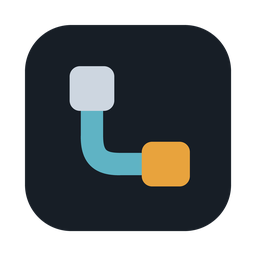

<p align="center">
  
</p>

<h1 align="center">Lepons</h1>

<p align="center"><b>한국어</b> · <a href="README.en.md">English</a> · <a href="README.zh-CN.md">中文</a></p>

<p align="center"><b>내 PC와 원격 서버의 AI 코딩 작업을 한 화면에서</b></p>

<p align="center">화면을 나눠 AI와 터미널, 파일을 함께 보고, 컴퓨터 사이에 코드를 공유하세요. 원격 PC와 AI 로그인을 관리하고, 밖에서는 폰으로 작업을 확인하고 답할 수 있습니다.</p>

<!-- SCREENSHOT: hero
     파일: 나중에 스크린샷 작업에서 추가 (예: screenshots/hero.png)
     내용: 여러 PC의 세션이 패널·탭으로 나뉜 메인 화면
     alt: "Lepons 메인 화면: 왼쪽에 PC와 폴더 목록, 오른쪽에 여러 PC의 AI 세션이 패널과 탭으로 나뉘어 있습니다" -->

## 다운로드

**[최신 버전 받기](https://github.com/joyuno/lepons/releases/latest)** · 소개 페이지: [lepons.app](https://lepons.app)

| 기기 | 받는 곳 |
|---|---|
| Windows 10/11 | [최신 릴리스](https://github.com/joyuno/lepons/releases/latest)의 `.exe` 설치 파일 |
| macOS (Apple Silicon, M1 이상) | [최신 릴리스](https://github.com/joyuno/lepons/releases/latest)의 `.dmg` |
| iPhone | App Store 심사 중입니다. 곧 나옵니다. |
| Android | [최신 릴리스](https://github.com/joyuno/lepons/releases/latest)의 `.apk`를 직접 받습니다. Google Play 출시도 준비하고 있습니다. |

### 설치

- **Windows**: 받은 `.exe`를 실행합니다. 설치 화면은 한국어·영어·중국어 중에서 고를 수 있습니다. "Windows의 PC 보호" 창이 뜨면 **추가 정보 → 실행**을 누릅니다. 코드 서명 인증서가 없는 앱이라 뜨는 경고입니다. 브라우저가 다운로드를 막으면 **유지**를 고릅니다.
- **macOS**: `.dmg`를 열고 Lepons Cockpit을 응용 프로그램 폴더로 끌어다 놓습니다. 처음 열 때 "Apple이 'Lepons Cockpit'에 악성 코드가 없는지 확인할 수 없습니다" 같은 경고가 뜨면 **시스템 설정 → 개인정보 보호 및 보안**에서 아래쪽의 **그래도 열기**를 누릅니다. 그래도 열리지 않으면 터미널에서 아래 명령을 한 번 실행한 뒤 다시 엽니다.

  ```sh
  xattr -dr com.apple.quarantine "/Applications/Lepons Cockpit.app"
  ```

- **Android**: 폰에서 릴리스 페이지의 `.apk`를 받아 엽니다. "이 출처의 앱 설치"를 허용하라는 창이 뜨면 허용하고 설치합니다. 파일의 SHA-256 값은 릴리스 페이지에 적어 둡니다.

## 무엇을 하나요

### 1. 공유 맵 — 다른 PC의 AI와 코드 공유

공유 맵에서 폴더를 다른 PC로 끌어다 놓으면 그 PC의 AI가 필요한 파일을 읽고 검색합니다. 코드를 복사하거나 Git으로 옮기지 않아도 다른 컴퓨터의 프로젝트를 참고할 수 있습니다.

공유받은 AI는 파일을 직접 수정하지 못하지만, 폴더가 있는 PC의 AI에게 작업을 맡길 수 있습니다. 맡긴 작업은 권한 확인 없이 실행되므로 믿을 수 있는 PC끼리만 공유하세요. 키나 토큰처럼 보이는 값은 가려서 전달합니다.

### 2. 모든 PC의 AI 에이전트를 한 화면에서

- 폴더를 누르고 **Claude Code, Codex, Grok, Antigravity, Cursor**, 터미널 중 하나를 고르면 그 폴더에서 바로 열립니다. 이 PC든, SSH로 닿는 VM·서버든 같습니다.
- 화면을 오른쪽·아래로 나눠 최대 여덟 개 패널을 띄웁니다. 한 패널에는 한 프로젝트(PC와 폴더)의 AI 세션·터미널·파일이 탭으로 모이고, 탭을 패널 가장자리로 끌면 새 패널로 나뉩니다.
- 마크다운, 코드, 이미지, PDF, HTML을 패널 안에서 열고, 원격 PC의 파일도 그 자리에서 고쳐 **Ctrl+S**(macOS는 **⌘+S**)로 저장합니다.
- 원격 PC에는 Lepons를 설치하지 않습니다. SSH만 되면 됩니다. 원격 세션은 tmux 위에서 돌아서, 노트북을 덮거나 네트워크가 끊겨도 에이전트는 하던 일을 계속하고 다시 열면 그 화면에 그대로 붙습니다.

### 3. 워크플로우 지도

<!-- SCREENSHOT: workflow-map
     파일: 나중에 스크린샷 작업에서 추가 (예: screenshots/workflow-map.png)
     내용: PC 허브에서 폴더·세션·서브에이전트가 뻗고, 항목 아래 요약이 보이는 지도
     alt: "워크플로우 지도: PC마다 허브가 있고 폴더, 세션, 서브에이전트가 가지를 뻗으며, 각 세션 아래에 지금 하는 일과 목표가 적혀 있습니다" -->

세션 기록을 읽지 않아도 무엇을 하려고, 어디까지 했고, 지금 무엇을 하며, 나를 기다리는지 한눈에 봅니다. 왼쪽 아래 **워크플로우**나 **Ctrl+Shift+M**(macOS는 **⌘⇧M**)으로 엽니다.

- **PC마다 허브 하나.** 이 PC와 원격 PC·VM이 각자 허브를 갖고, 거기서 폴더 → 세션 → 서브에이전트로 가지가 뻗습니다. 허브 둘레의 색이 연결 상태입니다.
- **늘 보이는 요약.** 항목 아래 요약은 마우스를 올리지 않아도 보입니다. 세션을 누르면 오른쪽에 요약 카드(**목표 · 진행 · 지금 · 결과**)가 나오고, 그 아래로 단계 목록이 이어집니다.
- **확인 필요 N.** 답을 기다리는 세션이 있으면 위쪽 막대에 **확인 필요 N**이 뜹니다. 누르면 다음으로 기다리는 세션을 지도에서 보여 주고, **그 칸으로 가기**로 그 패널에 가서 답합니다. 지도는 보기만 합니다.
- **집중 모드.** 허브나 폴더를 두 번 누르면 그 가지만 크게 보고, Esc로 돌아옵니다.
- **자동 관전.** 켜 두면 새로 일을 시작하거나 답을 기다리는 세션 쪽으로 지도가 따라갑니다. 지도를 만지면 30초 쉽니다.
- **뜻이 있는 곳에만 움직임.** 진행 중인 PC 사이 위임과 공유는 점선이 흐르고, 작업 중인 세션에는 옅은 점이 흘러 들어가고, 답을 기다리는 세션은 테두리가 깜빡입니다. 나머지는 가만히 있습니다.

### 4. 폰 앱

<!-- SCREENSHOT: phone
     파일: 나중에 스크린샷 작업에서 추가 (예: screenshots/phone.png)
     내용: 폰 앱의 홈(사용량·세션 상태)과 세션 대화 화면
     alt: "Lepons 폰 앱: 홈에서 실행 중·입력 대기 세션과 사용량 한도를 보고, 세션 화면에서 대화를 읽고 답합니다" -->

자리를 떠나도 iPhone·Android용 **Lepons** 앱으로 이 PC의 세션을 보고 답합니다.

- **QR로 페어링.** PC 화면의 QR을 폰 앱으로 찍고, 양쪽에 같은 6자리 숫자가 보이는지 확인합니다.
- **종단간 암호화.** 폰과 PC는 중계 서버(`relay.lepons.app`)를 거쳐 어디서든 연결되고, 오가는 내용은 이 PC와 폰만 읽을 수 있습니다. 중계 서버는 내용을 읽을 수 없습니다.
- **조용한 알림.** 세션이 입력을 기다릴 때만 알립니다. 여러 세션이 몰려 기다리면 알림 하나로 묶고, PC 앞에서 방금 입력했거나 폰 앱을 보고 있으면 보내지 않습니다. 일이 모두 끝나면 소리 없이 한 번 알려 주는 **완료 요약**은 고를 수 있습니다. 알림에는 PC 이름만 들어갑니다.
- **보고 답하기.** PC의 패널과 탭 그대로 세션을 보고, 대화를 읽고, 메뉴 번호·Enter·다음 지시를 보냅니다. 멈추기(Esc)는 두 번 눌러야 하고, 폰에서는 에이전트를 끌 수 없습니다.
- **지도·파일·사용량.** PC 한 대씩 워크플로우 지도를 보고, 세션 폴더의 마크다운·PDF·이미지를 열고, Claude·Codex 사용량 한도와 AI 계정 상태를 봅니다. PC 없이 둘러보는 **데모**도 있습니다.

### 5. 그 밖에

- **사용량 한도를 실시간으로**: Claude·Codex 요금제의 5시간·7일 한도 남은 양을 배터리로 보여 줍니다. 이 PC의 Claude가 답할 때마다 바로 바뀌고, 원격 PC 세션은 한 차례 일을 마칠 때 바뀝니다.
- **원격 PC의 AI 로그인**: **⚙ 설정 → AI 계정**에서 PC마다 어떤 AI가 설치·로그인됐는지 보고, 원격 PC도 터미널 없이 로그인합니다.
- **tmux 한 번에 설치**: tmux가 없는 원격 PC에는 **tmux 설치하기**가 뜨고, 누르면 Lepons가 뒤에서 설치합니다. sudo 암호가 필요하면 Lepons 창에서 한 번 묻고 저장하지 않습니다.
- **펫**: 바탕화면의 오리(produck)가 입력을 기다리는 세션을 알려 주고, 누르면 그 세션이 열립니다.

## 시작하기

처음 실행하면 주요 버튼을 짚어 주는 안내가 나옵니다. 다시 보려면 **⚙ 설정 → 튜토리얼**을 누릅니다(설정은 Ctrl+, / ⌘+,).

1. **PC 추가**: 왼쪽 아래 **＋ PC 추가**에서 **＋ 이 PC 폴더**나 **＋ 원격 PC**(`<사용자 이름>@<IP주소 또는 호스트명>`, 예: `ubuntu@10.0.0.5`)를 고릅니다. 처음이라면 VS Code·Cursor·Claude Code·Codex가 기억하는 곳을 한 번에 가져오는 **기존 작업 불러오기**가 편합니다.
2. **처음 연결**: 원격 PC에 Lepons 키가 없으면 비밀번호를 한 번 묻고, 키를 `~/.ssh/authorized_keys`에 대신 넣습니다. 비밀번호는 저장하지 않습니다.
3. **세션 열기**: 폴더를 누르고 에이전트를 고릅니다. **마지막 대화 이어가기**가 기본으로 켜져 있고, Claude Code·Codex는 **지난 대화 고르기…**로 예전 대화를 골라 이어 갈 수 있습니다. **권한 확인 없이 실행**은 기본으로 꺼져 있습니다. 믿을 수 있는 폴더에서만 켜세요.
4. **폰 연결**: 폰에 Lepons 앱을 설치하고, PC에서 폰 아이콘 → **폰 연결 가이드**로 폰 로그인 비밀번호와 인증 앱(Google Authenticator 등)을 정한 뒤 **폰 접속 허용**을 켭니다. **⚙ 설정 → 폰 앱 → 폰 앱 연결**의 QR을 2분 안에 찍고, 숫자가 같으면 PC에서 **맞아요**를 누릅니다. 폰에서 비밀번호와 인증 앱 코드로 로그인합니다.

### 필요한 것

- **이 PC**: Windows 10/11 또는 macOS(Apple Silicon)
- **원격 PC**: SSH 접속(비밀번호 또는 키). tmux 권장
- **AI 에이전트**: 쓸 에이전트의 설치와 로그인. 없으면 Lepons가 지금 설치할지 묻고 그 PC의 터미널에 공식 설치 명령을 넣어 줍니다.
- **폰(선택)**: Lepons 앱. PC와 같은 네트워크에 있지 않아도 됩니다. PC 한 대에는 폰 하나가 연결됩니다.

## Lepons가 연결하는 곳

- 추가한 PC: SSH로만 접속합니다.
- 중계 서버(`relay.lepons.app`): 폰 앱을 연결한 경우에만 씁니다. 내용은 종단간 암호화되어 중계 서버가 읽을 수 없습니다.
- 폰 알림: 알림을 켜면 Expo 푸시 서비스를 거쳐 Apple·Google 푸시로 보냅니다. PC 이름만 들어갑니다.
- GitHub: 새 버전을 확인하고 받을 때.
- Claude(Haiku 모델): 워크플로우 단계 목록의 **번역** 버튼을 누를 때만, 이 PC의 Claude Code로 번역합니다.
- 그 밖에 Lepons가 직접 보내는 데이터는 없습니다. 각 에이전트는 각자의 서비스에 연결합니다.

## 자주 묻는 질문

**원격 PC에 무엇을 설치해야 하나요?**
Lepons는 설치하지 않습니다. SSH만 되면 되고, 끊겨도 작업이 이어지도록 tmux를 권장합니다. 쓸 AI 에이전트는 그 PC에 있어야 합니다.

**Windows PC를 원격 PC로 쓸 수 있나요?**
네. Windows는 SSH 서버가 꺼져 있으니, 그 PC의 Lepons에서 **⚙ 설정 → 다른 PC에서 연결 → 허용하기…**를 한 번 누릅니다. OpenSSH 서버를 켜고, 방화벽은 같은 네트워크(LAN)에서 오는 SSH만 엽니다. 회사 PC라면 먼저 IT 담당자에게 허락을 받아 주세요.

**업데이트는 어떻게 하나요?**
Lepons를 켤 때 새 버전을 확인하고 알려 줍니다. **지금 업데이트**를 누르면 앱 안에서 받아 설치합니다. 앱 안 업데이트가 안 되는 macOS 릴리스는 다운로드 페이지를 엽니다. 등록한 PC와 설정은 그대로 남습니다.

**폰 로그인은 얼마나 유지되나요?**
한 번 로그인하면 10시간 동안 유지됩니다. PC가 잠자기에 들어가면 폰에서 접속할 수 없으니, 전원 설정에서 잠자기를 꺼 두세요.

**VS Code Remote-SSH나 터미널 앱과 무엇이 다른가요?**
Remote-SSH는 원격에 VS Code Server를 설치해 개발 환경을 만듭니다. Lepons는 원격에 아무것도 설치하지 않고, 여러 PC의 에이전트 세션을 한 창에 두고, 지도와 폰으로 무엇을 하는지 보여 줍니다.

**무료인가요?**
네, 무료입니다. 라이선스는 소스를 공개할 때 함께 정리할 예정입니다.

## 지원

- 개인정보처리방침: https://lepons.app/privacy
- 이용약관: https://lepons.app/terms
- 지원: https://lepons.app/support
- 문제나 제안: [Issues](https://github.com/joyuno/lepons/issues)
