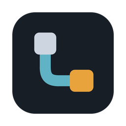

  

<h1 align="center">Lepons</h1>

<a href="README.md">한국어</a> · <a href="README.en.md">English</a> · <b>中文</b>

<b>多台电脑上的 AI 智能体，汇集到一个屏幕上</b>

分屏查看 AI 会话、终端和文件，在电脑之间共享代码。管理远程电脑和 AI 登录，离开电脑时也能在手机上查看工作并回复。

<!-- SCREENSHOT: hero
     文件：之后由截图任务添加（例如 screenshots/hero.png）
     内容：多台机器的会话分布在面板和标签中的主界面
     alt: "Lepons 主界面：左侧是机器和文件夹列表，右侧是多台机器的 AI 会话，分布在面板和标签中" -->

## 下载

**[获取最新版本](https://github.com/joyuno/lepons/releases/latest)** · 网站：[lepons.app](https://lepons.app/en/)

| 设备 | 获取方式 |
|---|---|
| Windows 10/11 | [最新版本](https://github.com/joyuno/lepons/releases/latest)中的 `.exe` 安装程序 |
| macOS（Apple Silicon，M1 及以上） | [最新版本](https://github.com/joyuno/lepons/releases/latest)中的 `.dmg` |
| iPhone | 在 [App Store](https://apps.apple.com/app/id6829282468) 下载。 |
| Android | 从[最新版本](https://github.com/joyuno/lepons/releases/latest)直接下载 `.apk`。Google Play 版本也在准备中。 |

### 安装

- **Windows**：运行 `.exe`。安装界面可选择韩语、英语或中文。如果出现"Windows 已保护你的电脑"，选择 **更多信息 → 仍要运行**。这是因为应用没有代码签名证书。如果浏览器拦截下载，选择 **保留**。
- **macOS**：打开 `.dmg`，把 Lepons Cockpit 拖进"应用程序"文件夹。应用已通过 Apple 签名和公证，可以直接打开，不会出现警告。从 1.9.6 起，应用内更新会打开新的 `.dmg`，把新应用拖到旧应用的位置即可，文件夹权限会保留。
- **Android**：在手机上从版本页面下载 `.apk` 并打开。如果系统要求允许安装此来源的应用，允许后安装即可。文件的 SHA-256 值列在版本页面上。

## 能做什么

### 1. 共享地图 — 与另一台电脑上的 AI 分享代码

在共享地图上把文件夹拖到另一台电脑，该电脑上的 AI 就能读取和搜索所需文件，无需复制代码或通过 Git 传送。

这个功能为这些情况而做：在公司内网工作、有不想放到 GitHub 上的文件、嫌每次提交推送拉取太麻烦，或者还不熟悉 Git。用 Git 搬代码只会带走文件，带不走对话，另一台电脑上的 AI 得把同样的文件从头再读一遍。在 Lepons 里，那台电脑的 AI 只在原处读取需要的文件，省下来回搬运和解释的工夫，也省下 token。

接收方的 AI 不能直接修改这些文件，但可以把任务交给文件夹所在电脑上的 AI。委派的任务会跳过权限确认运行，因此请只在可信的电脑之间共享。发送前会遮盖看起来像密钥或令牌的值。

### 2. 在一个窗口里使用所有机器的 AI 智能体

- 点击文件夹，选择 **Claude Code、Codex、Grok、Antigravity、Cursor、OpenCode** 或终端，即在该文件夹中打开。本机和通过 SSH 访问的虚拟机、服务器都一样。
- **本地 LLM 和 API 密钥模型**：用 OpenCode 运行自有服务器上的模型（Ollama、LM Studio、vLLM），或 OpenRouter、OpenAI、Anthropic、Google Gemini、DeepSeek、Groq 的 API 密钥模型。打开会话时在 **我的 LLM** 中选择；API 密钥只加密保存在本机的 **⚙ 设置 → 我的 API 密钥** 中，用身份验证器验证码查看原文。
- 向右或向下拆分，最多八个面板。一个面板以标签形式汇集一个项目（一台机器和一个文件夹）的 AI 会话、终端和文件；把标签拖到面板边缘即可拆出新面板。
- Markdown、代码、图片、PDF、HTML 都能在面板中打开，远程机器上的文件也能直接编辑，用 **Ctrl+S**（macOS 为 **⌘+S**）保存。
- 远程机器上无需安装 Lepons，只要能 SSH 登录即可。远程会话运行在 tmux 中，合上笔记本或断网后智能体继续工作，重新打开即回到原来的画面。

### 3. 工作流地图

<!-- SCREENSHOT: workflow-map
     文件：之后由截图任务添加（例如 screenshots/workflow-map.png）
     内容：机器中枢延伸出文件夹、会话和子代理，每一项下方显示摘要
     alt: "工作流地图：每台机器一个中枢，延伸出文件夹、会话和子代理，每个会话下方显示当前在做什么以及目标" -->

不用阅读会话记录，就能看到每个会话想做什么、做到哪里、现在在做什么、是否在等你。点左下角的 **工作流** 或按 **Ctrl+Shift+M**（macOS 为 **⌘⇧M**）打开。

- **每台机器一个中枢。** 本机和每台远程 PC、虚拟机各有一个中枢，向外延伸出文件夹 → 会话 → 子代理。中枢外圈的颜色表示连接状态。
- **始终可见的摘要。** 每一项下方的摘要无需悬停即可看到。点击会话，右侧会出现摘要卡片（**目标 · 进度 · 当前 · 结果**），下方是步骤列表。
- **待确认 N。** 有会话在等待回复时，顶部栏会出现 **待确认 N**。点击后在地图上显示下一个等待中的会话，再用 **前往其面板** 到那个面板里回复。地图本身只用于查看。
- **聚焦模式。** 双击中枢或文件夹只看那一支，按 Esc 返回。
- **自动跟随。** 开启后，地图会移到开始工作或等待你的会话。触碰地图后暂停 30 秒。
- **只在有意义的地方动。** 进行中的机器间委派和共享以流动虚线表示，工作中的会话有淡淡的点流入，等待中的会话边框闪烁。其余部分保持静止。

### 4. 手机应用

<!-- SCREENSHOT: phone
     文件：之后由截图任务添加（例如 screenshots/phone.png）
     内容：手机应用的首页（用量、会话状态）和会话对话画面
     alt: "Lepons 手机应用：首页显示运行中和等待输入的会话以及用量上限，会话画面可以阅读对话并回复" -->

**把所有电脑上的所有代理握在一只手里。** 离开座位，工作也不会停。用 iPhone 和 Android 版 **Lepons** 应用，在一个屏幕上管理电脑和服务器上的 AI 代理。

- **多台电脑。** 每台安装了 Lepons 的电脑用二维码连接一次，之后点主页顶部的电脑名称即可切换。每台电脑分别记住登录，所有已连接的电脑都会发来通知，点按通知就切换到那台电脑。

- **一目了然的首页。** 马上看到正在工作、等你回复、已完成的任务各有多少，需要回复的任务排在最前面。这里还能查看每个 AI 的剩余用量和最近 7 天的记录。
- **会话管理。** 按电脑打开、关闭会话，断开的会话可以重新连接。按 worktree 拆分的工作收在项目下面，点一下就展开。
- **聊天。** 接着电脑上的对话继续。AI 给出选项时点一下即可选择，也可以自己输入回复，或附上照片、文件。
- **通知。** AI 给出选项，或因错误、用量上限而停下时会通知你。多个同时出现时合并为一条，正在看手机应用时不发送。通知包含文件夹、AI 和电脑的名称以及一行固定提示。
- **工作流。** 在地图上查看电脑、服务器、文件夹和 AI 任务之间的关系。点开任务，就能看到目标、进展和当前在做的事的简短摘要。
- **终端和文件。** 在手机上打开电脑的终端并执行命令。浏览项目文件夹时，支持图片附件与查看、易读的代码显示以及 HTML。
- **安全连接。** 扫一次二维码即可连接。内容经过中继服务器（`relay.lepons.app`）时全程端到端加密，中继服务器无法读取；登录时还需要密码和身份验证器验证码。
- **演示。** 在首屏点 **看看演示**，无需电脑即可浏览所有画面。
- **更新。** 在设置的 **应用版本** 里可直接前往商店（或 APK）的更新页面。

### 5. 其他

- **实时用量上限**：以电池形式显示 Claude 和 Codex 套餐 5 小时、7 天上限的剩余量。本机的 Claude 每次回复后立即更新；远程会话在完成一轮工作时更新。
- **AI 安装与登录**：在 **⚙ 设置 → AI 账号** 中查看每台机器安装并登录了哪些 AI。缺少的 AI 和 OpenCode 可以在这里安装，远程机器也无需终端即可登录。
- **一键安装 tmux**：没有 tmux 的远程机器会显示 **安装 tmux**，点击后 Lepons 在后台安装。需要 sudo 密码时，Lepons 会在自己的对话框里询问一次，不会保存。
- **不用终端也能设置**：应用以韩语为先，同时支持英语和中文。安装和登录 AI、连接远程电脑、连接手机都按按钮和引导完成，非开发者也几乎不用打开终端就能完成基本设置。
- **用量**：在 **⚙ 设置 → 用量** 中按项目和模型查看本机及通过 SSH 连接的远程电脑最近 7 天的记录。远程电脑的项目会标上电脑名称，只读取数字，不读取对话内容。
- **拖到外面**：把侧边栏中的文件或文件夹拖到桌面、资源管理器、Finder 或其他接受文件的应用。远程电脑上的文件会先下载过来。
- **宠物**：桌面上的小鸭子（produck）提示哪个会话在等你，点击即打开该会话。

## 快速开始

首次启动时会有一段简短的引导介绍主要按钮。想再看一遍，点 **⚙ 设置 → 教程**（设置也可用 Ctrl+, / ⌘+, 打开）。

1. **添加机器**：在左下角 **＋ 添加机器** 中选择 **＋ 本机文件夹** 或 **＋ 远程机器**（`<用户名>@<IP 地址或主机名>`，例如 `ubuntu@10.0.0.5`）。第一次使用时，**导入** 很方便：它会一次性导入 VS Code、Cursor、Claude Code 和 Codex 记住的位置。
2. **首次连接**：如果远程机器上还没有 Lepons 的密钥，会询问一次密码，并替你把密钥写入 `~/.ssh/authorized_keys`。密码不会保存。
3. **打开会话**：点击文件夹并选择智能体。**继续上次对话** 默认开启；Claude Code 和 Codex 还可以用 **选择以前的对话…** 继续更早的对话。**跳过权限确认运行** 默认关闭，只在可信的文件夹中开启。
4. **连接手机**：在手机上安装 Lepons 应用。在电脑上点手机图标 → **手机连接指南**，设置手机登录密码和身份验证器应用（Google Authenticator 等），然后开启 **允许手机访问**。在 **⚙ 设置 → 手机应用 → 连接手机应用** 中于两分钟内扫描二维码，数字一致就在电脑上点 **是的**。之后在手机上用密码和身份验证器代码登录。

### 系统要求

- **本机**：Windows 10/11 或 macOS（Apple Silicon）
- **远程机器**：可以 SSH 登录（密码或密钥），推荐安装 tmux
- **AI 智能体**：已安装并登录要用的智能体。如果没有，Lepons 会询问是否立即安装，并在那台机器的终端里输入官方安装命令。
- **手机（可选）**：Lepons 应用。不需要和电脑在同一网络。一台电脑连接一部手机，一部手机可以连接多台电脑。

## Lepons 会连接哪里

- 你添加的机器：只通过 SSH 连接。
- 中继服务器（`relay.lepons.app`）：只在连接手机应用时使用。内容端到端加密，中继服务器无法读取。
- 手机通知：开启后经 Expo 推送服务发送到 Apple 和 Google 推送。包含文件夹、AI 和电脑的名称以及一行固定提示。
- GitHub：检查和下载新版本时。
- Claude（Haiku 模型）：只在工作流步骤列表中点击 **翻译** 时，用本机的 Claude Code 翻译。
- 除此之外 Lepons 不会自行发送任何数据。各智能体各自连接自己的服务。

## 常见问题

**远程机器上需要安装什么？**
不需要安装 Lepons。能 SSH 登录即可，推荐安装 tmux，断线后工作也能继续。要用的 AI 智能体需要装在那台机器上。

**Windows 电脑可以作为远程机器吗？**
可以。Windows 默认关闭 SSH 服务器，在那台电脑的 Lepons 中点一次 **⚙ 设置 → 允许其他电脑连接 → 允许…**。它会开启 OpenSSH 服务器，防火墙只放行来自同一网络（LAN）的 SSH。如果是公司电脑，请先征得 IT 负责人同意。

**怎么更新？**
Lepons 启动时会检查新版本并提示。点 **立即更新** 即在应用内下载并安装。无法在应用内更新的 macOS 版本会打开下载页面。已添加的机器和设置都会保留。

**手机登录能保持多久？**
10 小时。电脑进入睡眠后手机无法连接，请在电源设置中关闭睡眠。

**和 VS Code Remote-SSH 或终端应用有什么不同？**
Remote-SSH 会在远程机器上安装 VS Code Server 来搭建开发环境。Lepons 不在远程安装任何东西，把多台机器的智能体会话放在同一个窗口里，并通过地图和手机告诉你它们在做什么。

**免费吗？**
免费。Lepons 是采用 MIT 许可证的开源项目，源代码就在本仓库中。

## 支持

- 隐私政策：https://lepons.app/privacy
- 使用条款：https://lepons.app/terms
- 支持：https://lepons.app/support
- 咨询与反馈：欢迎随时发邮件到 [joy981017@gmail.com](mailto:joy981017@gmail.com)，问题、不便或想要的功能都可以。
- 问题或建议：[Issues](https://github.com/joyuno/lepons/issues)
