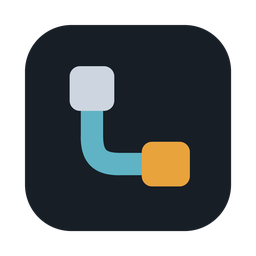

<p align="center">
  
</p>

<h1 align="center">Lepons</h1>

<p align="center"><a href="README.md">한국어</a> · <a href="README.en.md">English</a> · <b>中文</b></p>

<p align="center"><b>多 PC 智能体编排器：在一个窗口里驱动所有机器上的 AI 编程智能体</b></p>

<p align="center">一款桌面应用：把本机和远程服务器、虚拟机上运行的 Claude Code 与 Codex 会话并排放在同一个窗口里，并让这些机器实时互相读取代码库。</p>

不必再为每台服务器、工作站和笔记本分别打开终端，也不必在它们之间复制代码和文件。远程机器上无需安装任何东西，只要能 SSH 登录即可。

## 下载

**[获取最新版本](https://github.com/joyuno/lepons/releases/latest)**

| 操作系统 | 文件 |
|---|---|
| Windows 10/11 | `.exe` 安装程序 |
| macOS（Apple Silicon，M1 及以上） | `.dmg` |

### 安装

- **Windows**：运行 `.exe`。安装界面可选择韩语、英语或中文。如果出现"Windows 已保护你的电脑"，选择 **更多信息 → 仍要运行**。这是因为应用没有代码签名证书。如果浏览器拦截下载，选择 **保留**。
- **macOS**：打开 `.dmg`，把 Lepons Cockpit 拖进"应用程序"文件夹。应用未经过 Apple 公证，首次打开时会提示类似"Apple 无法验证'Lepons Cockpit'是否包含恶意软件"的警告。这时前往 **系统设置 → 隐私与安全性**，点击下方的 **仍要打开**（1.7.2 及以上）。

  如果仍然打不开，或 1.7.1 及以下提示"已损坏，无法打开"，在终端里执行一次下面的命令后再打开：

  ```sh
  xattr -dr com.apple.quarantine "/Applications/Lepons Cockpit.app"
  ```

## 主要功能

1. **PC 之间共享代码库**：在共享图上把文件夹拖到另一台 PC 上，那台 PC 的 Claude Code 和 Codex 就能读取和搜索它。不需要 git push/pull，也不用复制文件。接收方的智能体只能读取这个文件夹，不能直接修改；看起来像密钥或令牌的值会先遮盖再发送。需要修改时，可以把任务交给文件夹所在的 PC，该任务会在那台 PC 上跳过权限确认运行。只在可信的 PC 之间共享。
2. **自由拆分面板与标签**：向右或向下拆分，面板数量取决于屏幕大小，最多八个，也可以用 ⤢ 只看一个。一个面板以标签形式汇集一个项目（一台 PC 和一个文件夹）的 AI 会话、终端和文件，不同 PC 的工作可以并排查看。
3. **启动 AI 智能体或终端**：点击文件夹，选择 Claude Code、Codex、Grok、Antigravity、Cursor 或终端，即在该文件夹中打开。Lepons 启动后，每台 PC 的第一个会话会先把 CLI 更新到最新版；模型跟随 CLI 自己的最新默认模型。也可以继续该文件夹的上一次对话，或从列表中选择以前的对话继续。
4. **断线也不中断的工作**：远程会话运行在 tmux 中。合上笔记本或断网后智能体继续工作，重新打开即回到原来的画面。
5. **远程无需安装**：没有守护进程，也没有服务器程序。会话和代码共享都只走 SSH。首次连接时输入一次密码，Lepons 会替你登记 SSH 密钥。Windows 电脑默认关闭 SSH 服务器，在那台电脑的 Lepons 中点一次 **⚙ 设置 → 允许其他电脑连接 → 允许…**，或粘贴文档指南中的命令即可。
6. **在面板中查看和编辑文件**：Markdown（含 Obsidian 语法）、代码、图片、PDF、HTML 都能在面板中打开，本机和远程 PC 的文件可直接编辑。文本文件打开即可编辑，用 **Ctrl+S**（macOS 为 **⌘+S**）保存；有未保存的修改时关闭会询问是否保存。文件树和 VS Code 一样支持右键复制、粘贴、重命名、删除、复制路径。
7. **工作流地图**：在一张地图上查看所有 PC 的文件夹、会话和子代理，不用打开记录就能看到每个会话的目标、现在在做什么以及 PC 之间传递了什么，并直接跳到等待你回复的会话。
8. **导入已有工作环境**：从 VS Code 和 Cursor 记住的远程文件夹，以及 Claude Code 和 Codex 的会话记录中，一次性导入机器和文件夹。
9. **用手机应用查看和回复会话**：通过 iPhone 和 Android 版 Lepons 应用（即将上架），外出时也能阅读会话对话、点选菜单数字或发送下一条指令。有会话等待输入时，手机会收到通知。手机与电脑之间的内容端到端加密，中间的中继服务器也无法读取。
10. **提醒你该回复的宠物**：桌面上的小鸭子（produck）会提示哪个会话在等你，点击即打开该会话。也可以导入自己的宠物。
11. **一次发给多个会话**：把同一条指令一次发送给多个打开的会话。
12. **关闭后接着用**：无论是意外退出还是正常关闭，下次启动时都会询问是否恢复之前打开的所有会话和面板。

## 快速开始

首次启动时会有一段简短的引导介绍主要按钮。想再看一遍，点左上角 **⚙ 设置 → 教程**。也可以用 Ctrl+,（macOS 为 ⌘+,）打开设置。每台 PC 需要准备的东西和安装命令集中在 **＋ 添加机器 → 文档指南** 中，它还会检查本机的状态。

### 远程 PC 准备

- 可以 SSH 登录（密码或密钥）
- tmux（推荐；没有它的话，断线时该会话的工作也会结束。没有 tmux 的 PC 会在列表中显示 **安装 tmux**，点击后 Lepons 会在后台安装；需要 sudo 密码时，Lepons 会在自己的对话框里询问一次，不会保存）
- 已安装并登录要用的 AI 智能体（Claude Code、Codex 等）（如果没有，Lepons 会询问是否立即安装，并在那台 PC 的终端里输入官方安装命令。在 **⚙ 设置 → AI 账号** 中可以查看每台 PC 的安装和登录状态，远程 PC 也无需终端即可登录）

PC 之间只通过 SSH 连接。一台 PC 即可管理所有能通过 SSH 访问的虚拟机和 PC。

### 添加机器

点击左下角 **＋ 添加机器**，有四个选项。

| 按钮 | 作用 |
|---|---|
| **＋ 本机文件夹** | 选择本机的文件夹进行登记。 |
| **＋ 远程机器** | 输入 `<用户名>@<IP 地址或主机名>`，例如 `ubuntu@10.0.0.5`。 |
| **导入** | 找出 VS Code、Cursor、Claude Code、Codex 记住的位置并一次性添加。第一次使用可以先点这里。 |
| **文档指南** | 显示本机、远程 PC、手机和宠物各自需要的东西、安装命令以及本机的 Lepons 公钥。 |

如果远程 PC 上还没有 Lepons 的密钥，会出现密码输入框。输入一次后，Lepons 会把密钥写入 `~/.ssh/authorized_keys`，之后都用密钥连接。密码不会被保存。如果服务器禁止密码登录，请在 **文档指南** 中复制公钥，粘贴到远程 PC 的 `~/.ssh/authorized_keys`。

### 打开文件夹

在左侧列表中点击文件夹，然后选择要运行的工具。

- **Claude Code / Codex / Grok / Antigravity / Cursor / 终端**：在该文件夹中启动。
- **继续上次对话**：默认勾选。以新会话继续该文件夹的上一次对话；没有可继续的对话时则新建。Claude Code 和 Codex 还可以点 **选择以前的对话…**，按标题查找该文件夹以前的对话；选中的对话会作为新对话继续，原对话保持不变。
- **跳过权限确认运行**：默认关闭。关闭时 Claude Code 以自动模式启动，Codex 以自动审查启动，只对有风险的操作请求确认。开启后跳过所有确认，Codex 也不使用沙箱。只在可信的文件夹中开启。

鼠标悬停在文件夹上时出现的 **⚙** 用于打开终端、新建文件、重命名、从列表中移除（磁盘上的文件保留），文件夹名称左侧的折叠箭头用于展开文件。**打开终端** 会在 Claude 或 Codex 会话旁边打开同一文件夹的普通终端，会话照常运行。展开的文件列表上方的按钮可以新建文件、新建文件夹、刷新、折叠所有文件夹；如果看不到智能体或终端新建的文件，请点刷新。面板标题栏的 **>_** 按钮或 Ctrl+`（macOS 为 ⌘+`）会以标签形式打开该项目的终端，PC 名称行的 **>_** 会在那台 PC 的主文件夹中打开终端。

### 让其他电脑连接这台电脑（Windows）

Windows 默认关闭 SSH 服务器。要让其他电脑的 Lepons 把这台电脑作为远程 PC 使用，点 **⚙ 设置 → 允许其他电脑连接 → 允许…**。确认一次管理员权限后，Lepons 会开启 OpenSSH 服务器，防火墙只放行来自同一网络（局域网）的 SSH 连接（规则名 `Lepons-SSH-LAN`）。同一标签中的 **关闭…** 可以全部恢复原样。如果是公司电脑，请先征得 IT 负责人同意。

## 手机应用

在手机上使用 iPhone 和 Android 版 **Lepons** 应用查看并回复这台电脑上的会话。应用即将在 App Store 和 Google Play 上架。

### 连接

1. 在电脑上点左上角的手机图标 → **手机连接指南**，设置手机登录密码和身份验证器（Google Authenticator 等），并开启 **允许手机访问**。
2. 点 **⚙ 设置 → 手机应用 → 连接手机应用** 会显示二维码。请在两分钟内用手机上的 Lepons 应用扫描。
3. 核对两边屏幕上的 6 位数字是否相同，相同则在电脑上点 **是的**。
4. 在手机应用中用密码和身份验证器的 6 位数字登录。

手机和电脑通过中继服务器（`relay.lepons.app`）连接，因此不需要在同一网络中。双方之间的内容端到端加密，只有这台电脑和手机能读取，中继服务器无法读取。一台电脑只连接一部手机；连接新手机后，之前的手机会解除配对。

### 手机应用可以做什么

- **首页**：查看运行中、等待输入和已完成的工作，Claude 和 Codex 的用量上限（5 小时、7 天），以及已登记 PC 的连接状态。断开的 PC 可以从手机请求重新连接。
- **会话**：按电脑上的面板和标签分组显示。
- **对话**：像聊天一样阅读智能体的对话，点菜单数字或发送下一条指令；发送空内容即按回车。停止图标需要点两次，才会中断智能体正在做的事（Esc）。手机无法结束智能体，请在 PC 上结束。
- **工作流**：按时间顺序查看每条指令下智能体做了什么。
- **文件**：打开会话文件夹中的 Markdown、PDF 和图片。
- **地图**：按 PC 在一张地图上查看文件夹和会话，点击会话即打开。
- **AI 账号**：仅查看电脑上 AI 的登录状态，登录和退出请在电脑上操作。
- **设置**：调整终端字号和通知。还有无需电脑即可浏览界面的 **演示** 模式。

### 通知

- **等待输入**：会话等待你回复时通知你。多个会话同时等待时合并为一条；你在电脑前或正在看应用时不会发送。
- **完成汇总**（可选）：正在工作的会话全部结束时，静音通知一次。
- 通知只包含 PC 名称，不包含智能体输出。

需要知道：

- 登录一次可保持 10 小时。
- 从手机发送的输入会在桌面上显示为"已从手机输入"。
- PC 进入睡眠后手机无法访问，请在电源设置中关闭睡眠。
- 隐私政策：https://lepons.app/privacy · 支持：https://lepons.app/support

## 宠物与等待输入提醒

- **⚙ 设置 → 宠物 → 开启**，桌面上会出现一只小鸭子（produck）。默认关闭。
- 它会随会话状态（工作中、等待输入、完成、连接中、断开、空闲）改变动作，点击即打开该会话。可以拖到任意位置，双击回到屏幕右下角。
- 同一标签中的 **导入宠物…** 可以导入按状态命名的图片文件夹（`idle.gif`、`working.gif` …，至少要有 `idle`）或 Codex Pet 文件夹。制作方法见 **查看指南**。
- 左侧列表中的圆点只在 **完成工作、等待你输入的会话** 上亮起。Lepons 被其他窗口遮住时，会话轮到你时还会弹出系统通知。

## 共享图

左下角的 **共享图** 用来让 PC 之间互相读取代码。

- **把文件夹拖到另一台 PC 的卡片上** 即开始共享，**点击连线** 即停止。
- **箭头表示代码流向。** `A → B` 表示 B 的 Claude Code 和 Codex 读取 A 的文件夹。互相共享时显示为一条双向箭头（`⇄`）。鼠标悬停在连线上，会用一句话说明谁读取了什么。
- 连接共享后，Lepons 会自动在那台 PC 上登记 Lepons MCP。接收方 PC 卡片上的 **MCP 接收方 [Claude] [Codex]** 开关决定登记给哪个智能体（一开始只有该 PC 的默认智能体）。已经打开的会话会出现 **应用 lepons** 按钮，点击后会继续对话并重新打开。
- 互相共享的 PC 会被并排放置，箭头更短。你亲手拖动过的卡片会保持原位。
- 从列表中删除某台 PC，与它相连的共享也会全部断开。
- 如果某台 PC 的文件夹看起来用到了另一台 PC 上某个文件夹提供的包（package.json、go.mod、Cargo.toml 等），会用虚线建议共享。点击即共享，右键可隐藏该建议。
- 左侧列表中，文件夹名称旁的 `↗N` 表示读取该文件夹的 PC 数，PC 名称旁的 `↙N` 表示这台 PC 读取的文件夹数。

### 代码共享方式

- 在共享图上连接后，Lepons 会在 SSH 连接之上打开反向隧道，并为那台 PC 的 Claude Code 和 Codex 登记 Lepons MCP。
- 接收方智能体用 `search_repo` 搜索，用 `read_file` 只打开需要的文件。每次请求，Lepons 只在原来的 PC 上读取那个文件或匹配到的行再传过去。
- 不会整库复制，也不会提前发送。只有智能体实际读取的部分进入上下文，所以只消耗这么多 token。
- 接收方智能体可以用 `delegate_task` 把任务交给原 PC，由那台 PC 的 Claude Code 或 Codex 跳过权限确认执行，用 `check_delegation` 查看进度。

## 工作流地图

点左下角的 **工作流**（Ctrl+Shift+M，macOS 为 ⌘⇧M），所有 PC 上的工作会显示在一张地图上。不用阅读会话记录，就能一眼看出它要做什么、做到哪一步、现在在做什么、是否在等你。

- 每台 PC 是一个带显示器图标的中心节点，文件夹和会话从这里分出，子代理再从会话分出。本机带有标记；远程 PC 带有 ↗ 标记，知道系统时还会显示操作系统。中心节点外圈的颜色表示连接状态。
- 各项下方的摘要无需悬停即可看到：会话显示现在在做什么和目标，子代理显示被交代的任务以及运行时长或结果，文件夹显示其中最忙的会话在做什么以及数量。
- 地图以 30% 大小打开，让所有 PC 都在画面里。只有有意义的地方才会动：共享关系和进行中的委派是流动的虚线，正在工作的会话有淡淡的点流入，等待回复的会话外圈会闪烁。
- 可以拖动中心节点或文件夹，位置会保留。双击可只聚焦那一支，按 Esc 返回。
- 点击会话，右侧面板顶部会显示摘要卡片（目标、进度、现在、结果），下方是步骤列表。等待回复的会话会显示问题和选项，点 **前往其面板** 到那个面板里回答。
- 打开 **自动跟随** 后，地图会跟着开始工作或开始等待回复的会话移动。
- 地图只用来查看，不能在这里发送命令或回答。
- 有会话等待回复时，顶栏会出现 **待确认 N**；点击会打开地图并显示下一个等待中的会话。
- 子代理的指令通常是英文。步骤列表中的 **翻译** 按钮会把它们翻译成应用语言，只有点击时才消耗本机少量 Claude 用量（Haiku 模型）。

## 在终端中

| 想要 | 操作 |
|---|---|
| 复制文字 | 拖动选择后按 **Ctrl+C**（没有选择时 Ctrl+C 是中断） |
| 粘贴 | **Ctrl+V**。如果剪贴板里只有图片（例如截图），会作为图片附加到 Claude Code 或 Codex；远程 PC 会先把图片传过去，再粘贴其路径。 |
| 输入时换行 | **Shift+Enter**（Claude Code、Codex） |
| 查看之前的输出 | 鼠标滚轮 |
| 打开链接 | **Ctrl+点击**（macOS 为 **⌘+点击**）。远程 PC 的 `localhost` 地址会把那台 PC 的端口转发到本机后打开，并在面板标题栏留下 `🌐 端口 ×`：点 🌐 再次打开，点 × 关闭转发。 |

## 界面

- **侧边栏**：顶部是 ⚙ 设置、手机图标和折叠；中间是 PC 及其文件夹；底部是 ＋ 添加机器、共享图和工作流。可以拖动文件夹和 PC 调整顺序，PC 名称左侧的折叠箭头可以收起它的文件夹（重启后保留）。
- **置顶**：任何 PC 的文件夹都可以置顶，集中显示在列表最上方。
- **管理机器**：点列表中的 **管理机器**，可以为每台 PC 重命名、修改连接信息、重新连接，以及选择是否在启动时自动连接。
- **顶栏**：待确认 N（有会话等待回复时）、拆分按钮（把当前选中的面板向右或向下拆分），以及 Windows 上的窗口按钮都在同一行。拖动顶栏即可移动窗口。
- **面板标签**：一个面板以标签形式汇集一个项目的会话、终端和文件，同一项目的面板带有相同颜色的色带。把标签拖到面板边缘，即拆分出同一项目的新面板。关闭标签后，会话仍在左侧列表中继续运行。
- **状态**：文件夹行末的圆点绿色表示正在工作，橙色闪烁表示正在连接，红色表示连接失败。完成工作、等待你输入的会话会另外亮起圆点。
- **同时发送给多个会话**：打开两个以上会话时，侧边栏会出现按钮。勾选会话后按 Ctrl+Enter 发送。
- **会话恢复**：无论是意外退出还是正常关闭，下次启动时都会询问是否恢复之前打开的所有面板和会话。远程会话会重新接上仍在 tmux 中运行的工作。想不再询问、总是重新打开，可在 **⚙ 设置 → 启动画面** 中开启。
- **用量**：有会话打开时，＋ 添加机器 上方会以五格电池显示 Claude 和 Codex 的套餐剩余用量（5h 为 5 小时限额，7d 为 7 天限额）。悬停可看精确比例和重置时间，左侧箭头可以折叠。只显示正在运行的智能体；Claude 在 Lepons 打开的会话回复一次后才会显示。本机的 Claude 每次回复后立即更新；远程 PC 在其会话完成一轮或打开该 PC 时更新。
- **主题**：在 **⚙ 设置 → 主题** 中选择浅色、深色或 **系统设置**（跟随电脑设置）。
- **字体**：在 **⚙ 设置 → 字体** 中设置终端和文件查看的字号与字体。D2Coding、JetBrains Mono、Fira Code 已随应用附带。
- **远程电脑管理**：在 **⚙ 设置 → 远程电脑管理** 中逐行查看已添加的远程 PC，用开关连接或断开。**⋯** 菜单可以修改地址、查看 AI 账号或删除。
- **语言**：支持韩语、英语、中文，在 **⚙ 设置 → 语言** 中切换。日期和时间也跟随所选语言。

## 更新

Lepons 在启动时以及点击 **⚙ 设置 → 更新 → 检查更新** 时，会把当前版本与 GitHub 上的最新发布进行比较。有新版本时会提示，点击 **立即更新** 即在应用内下载。下载的文件会先与 GitHub 上发布的文件核对再安装，随后 Lepons 会短暂关闭并以新版本重新打开。运行环境（Electron、原生模块、构建设置）未变的发布只下载变化的应用部分（约 14MB）。macOS 只在应用内进行这种小更新，其他发布会打开下载页面。已登记的 PC 和设置在更新后保持不变。

## Lepons 连接的地方

- 你添加的 PC：仅通过 SSH。
- 中继服务器（`relay.lepons.app`）：仅在开启 **允许手机访问** 并连接了手机应用时使用。手机与电脑之间的内容端到端加密，中继服务器无法读取。
- 手机通知：在手机应用中开启通知后，"等待输入"（以及选择开启的"完成汇总"）通知会经 Expo 推送服务发送到 Apple 或 Google 的推送，只包含 PC 名称。
- GitHub：在 Lepons 启动和点击 **检查更新** 时询问最新发布；点击 **立即更新** 时下载该发布的文件。
- Claude（Haiku 模型）：仅在工作流中点击 **翻译** 时，通过本机的 Claude Code 翻译那段文字，会消耗一些 Claude 用量。
- 除此之外，Lepons 自身不发送任何数据。Claude Code 和 Codex 各自连接自己的服务，首次启动时用各自的更新命令更新到最新版本。

## 与其他工具的区别

- **cmux** 是基于 Ghostty 的 macOS 原生终端，用竖向标签和通知帮你照看多个智能体。Lepons 运行在 Windows 和 macOS 上，并且不止于终端，还让 PC 之间互相读取代码。
- **VS Code + Remote-SSH** 会在远程机器上安装 VS Code Server 来构建远程开发环境。Lepons 不在远程安装任何东西，把多台 PC 的智能体会话并排放在一个窗口里。
- **普通终端和 SSH 客户端** 只负责连接。Lepons 为每个会话选择智能体、保持最新，并显示它在做什么。

问题和建议欢迎提交到 [Issues](https://github.com/joyuno/lepons/issues)。

## 许可证

免费使用。许可证将在源代码公开时一并确定。
